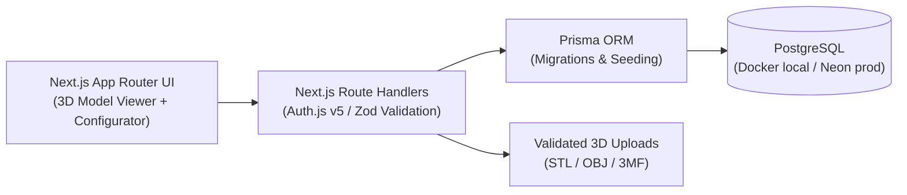

# FLYDES — 3D-Printed Automotive Parts Platform (B.Eng. Thesis)

[](https://praca-inzynierska-gamma.vercel.app/)
[](LICENSE)

Full-stack e-commerce and B2B platform for configuring, pricing, and ordering custom 3D-printed automotive parts (spoilers / aerodynamic components), built as a **Bachelor of Engineering thesis** at Cracow University of Technology.

**Live Demo:** [praca-inzynierska-gamma.vercel.app](https://praca-inzynierska-gamma.vercel.app/)

## Architecture



## Key Features

- **Step-by-Step Vehicle Configurator:** Guided selection (`Brand → Model → Generation → Part`) with an interactive **3D preview** powered by `@google/model-viewer`.
- **Cart & Server-Validated Checkout:** Client-side cart (`localStorage`) with authenticated checkout that re-verifies part availability (`archivedAt: null`) and current prices directly against PostgreSQL.
- **Custom 3D Print Quote Calculator:** Instant pricing estimator with optional 3D geometry upload (`STL`, `OBJ`, `3MF`), content validation, storage outside `public/` (`uploads/custom/`), and authorized downloads via `/api/uploads/custom/[filename]`.
- **Admin Dashboard (`/admin`):** Catalog management (create, edit, soft-archive, safe delete), order status workflow (`NEW → IN_PROGRESS → COMPLETED / REJECTED`), and custom quote approval/rejection with price adjustments and notes.
- **Automated Tests & Seeding:** Unit/smoke tests (`node:test` + `tsx`), reproducible Prisma migrations, and database seeding.

## Tech Stack

- **Framework & Language:** Next.js 16 (App Router), React 19, TypeScript
- **Database & ORM:** PostgreSQL, Prisma 6
- **Auth & Validation:** Auth.js (NextAuth v5 Credentials), Zod, bcryptjs
- **3D Visualization:** `@google/model-viewer`
- **DevOps & Deployment:** Docker Compose (local PostgreSQL), Vercel + Neon (production)

## Local Setup

### Prerequisites
- Node.js 20+ & npm
- Docker Desktop (for local PostgreSQL)

### Run Locally

```bash
# 1. Install dependencies
npm install

# 2. Configure environment variables
cp .env.example .env
# PowerShell: Copy-Item .env.example .env

# 3. Start PostgreSQL
docker compose up -d

# 4. Run Prisma migrations & seed sample data
npx prisma migrate dev
npm run db:seed

# 5. Start dev server
npm run dev
```

Open [http://localhost:3000](http://localhost:3000).

### Test Accounts

| Role  | Email                | Password    |
|-------|----------------------|-------------|
| ADMIN | `admin@flydes.local` | `Admin123!` |
| USER  | `user@flydes.local`  | `User123!`  |

*(Default seed passwords can be overridden via `SEED_ADMIN_PASSWORD` and `SEED_USER_PASSWORD`.)*

## Available Scripts

| Script | Description |
|--------|-------------|
| `npm run dev` | Start Next.js development server |
| `npm run build` | Generate Prisma Client and build production bundle |
| `npm start` | Run production server |
| `npm run lint` | Run ESLint checks |
| `npm test` | Run unit & smoke tests (`tsx --test tests/*.test.ts`) |
| `npm run db:migrate` | Apply development migrations (`prisma migrate dev`) |
| `npm run db:seed` | Seed PostgreSQL with sample catalog & test accounts |
| `npm run db:reset` | Reset database, re-run migrations, and re-seed |

## Application Routes

| Route | Purpose |
|-------|---------|
| `/` | Landing page |
| `/konfigurator` | Interactive 3D part configurator |
| `/wycena` | Custom 3D print quote & file upload |
| `/koszyk` | Shopping cart & checkout |
| `/zamowienia`, `/zamowienie/[id]` | User order history & order details |
| `/login`, `/register` | Authentication (`Credentials`) |
| `/admin` | Admin panel (`ADMIN` role) |

## Deployment (Vercel + Neon)

1. Provision a PostgreSQL database on [Neon](https://neon.tech) and copy `DATABASE_URL`.
2. Run production migrations and seed:
   ```bash
   export DATABASE_URL="postgresql://..."
   export SEED_ADMIN_PASSWORD="strong-admin-password"
   npx prisma migrate deploy
   npm run db:seed
   ```
3. Deploy to [Vercel](https://vercel.com) with `DATABASE_URL`, `AUTH_SECRET`, and `AUTH_URL`.

> **Serverless storage note:** Local 3D file uploads write to `uploads/custom/`. On read-only serverless filesystems (e.g., Vercel), quotes without attachments work normally while file uploads return an unavailable-storage notice (cloud persistence requires an object store such as S3 or Vercel Blob).

## 3D Model Attribution (CC-BY-4.0)

Sample 3D models in `/public/models/` are sourced from Sketchfab under [CC-BY-4.0](https://creativecommons.org/licenses/by/4.0/):
- `car_spoiler.glb` — *Car Spoiler* by [Prasad_bhushi](https://sketchfab.com/Prasad_bhushi) ([Sketchfab](https://sketchfab.com/3d-models/car-spoiler-98576be85f3f4867b16a31b20104da30))
- `drag_spoiler.glb` — *drag spoiler* by [ベータBETAベータ](https://sketchfab.com/max_ar99) ([Sketchfab](https://sketchfab.com/3d-models/drag-spoiler-d7a8d7d46c74435ea556c33afcecd9da))
- `universal_spoiler_1.glb` — *Universal Spoiler 1* by [the_86_guy](https://sketchfab.com/the_86_guy) ([Sketchfab](https://sketchfab.com/3d-models/universal-spoiler-1-5e118ed64b6b4cdb9b5a2931c06a0bc4))

## License

Source code is licensed under the [MIT License](LICENSE). Sample 3D models in `/public/models/` are licensed under CC-BY-4.0.
